

<a href="https://github.com/Kmykh">
  <picture>
    <source media="(prefers-color-scheme: dark)" srcset="./assets/banner-dark.svg"/>
    <source media="(prefers-color-scheme: light)" srcset="./assets/banner-light.svg"/>
    
  </picture>
</a>

 

<a href="https://github.com/Kmykh">
  <picture>
    <source media="(prefers-color-scheme: dark)" srcset="https://readme-typing-svg.demolab.com?font=Titillium+Web&weight=900&size=28&duration=2600&pause=900&color=FF2A1F&center=true&vCenter=true&width=900&lines=Maykol+Rojas+%E2%80%94+Software+Engineer;IA+aplicada+a+apps+m%C3%B3viles;L%C3%ADder+de+desarrollo+%C2%B7+Aura+Nova+%C2%B7+Aliada+%C2%B7+Vitalify;IA+responsable+%E2%80%A2+UX+Design+%E2%80%A2+Scrum"/>
    
  </picture>
</a>

---

## `$ whoami --driver`

Soy co-creador de **Aliada**, una app de seguridad para estudiantes universitarias: una alarma que avisa a personas cercanas con tu ubicación en el mapa, y **LumAI**, un asistente confidencial de primera orientación. Me especializo en **apps móviles, diseño UX, arquitecturas y gestión de equipos con Scrum**. En IA me enfoco en el **uso responsable**: ética, sesgos, aspectos legales y desarrollo con IA generativa.

<picture>
  <source media="(prefers-color-scheme: dark)" srcset="./assets/whoami-dark.svg"/>
  
</picture>

## `$ ls ./escuderias` proyectos que lidero

<picture>
  <source media="(prefers-color-scheme: dark)" srcset="./assets/leads-dark.svg"/>
  
</picture>

## `$ cat setup.json` stack

<picture>
  <source media="(prefers-color-scheme: dark)" srcset="./assets/stack-dark.svg"/>
  
</picture>

<picture>
  <source media="(prefers-color-scheme: dark)" srcset="https://skillicons.dev/icons?i=flutter,dart,react,nextjs,ts,js,spring,java,dotnet,cs,postgres,supabase,docker,figma,git,unity,arduino&theme=dark&perline=17"/>
  
</picture>

## `$ cat temas.log` formación

<picture>
  <source media="(prefers-color-scheme: dark)" srcset="./assets/topics-dark.svg"/>
  
</picture>

## `$ telemetry --live` habilidades

<picture>
  <source media="(prefers-color-scheme: dark)" srcset="./assets/radar-skills-dark.svg"/>
  
</picture>
<picture>
  <source media="(prefers-color-scheme: dark)" srcset="./assets/radar-langs-dark.svg"/>
  
</picture>

## `$ ls ./parrilla` proyectos públicos

<a href="https://github.com/Kmykh/AppMovil-VacApp"><picture><source media="(prefers-color-scheme: dark)" srcset="./assets/project-appmovil-vacapp-dark.svg"/></picture></a>
<a href="https://github.com/Kmykh/AccesiTour"><picture><source media="(prefers-color-scheme: dark)" srcset="./assets/project-accesitour-dark.svg"/></picture></a>
<a href="https://github.com/Kmykh/Page-Mindacode"><picture><source media="(prefers-color-scheme: dark)" srcset="./assets/project-page-mindacode-dark.svg"/></picture></a>
<a href="https://github.com/Kmykh/VideoGame-MaskInThePit"><picture><source media="(prefers-color-scheme: dark)" srcset="./assets/project-videogame-maskinthepit-dark.svg"/></picture></a>
<a href="https://github.com/Kmykh/Page-Transportify"><picture><source media="(prefers-color-scheme: dark)" srcset="./assets/project-page-transportify-dark.svg"/></picture></a>
<a href="https://github.com/Kmykh/Page-Donfy"><picture><source media="(prefers-color-scheme: dark)" srcset="./assets/project-page-donfy-dark.svg"/></picture></a>

## `$ git log --laps` contribuciones

<picture>
  <source media="(prefers-color-scheme: dark)" srcset="https://raw.githubusercontent.com/Kmykh/Kmykh/output/race-dark.svg"/>
  
</picture>

## `$ radio --box-box` contacto

  

<picture>
  <source media="(prefers-color-scheme: dark)" srcset="./assets/finish-dark.svg"/>
  
</picture>

