<a href="https://github.com/Kmykh">
  <picture>
    <source media="(prefers-color-scheme: dark)" srcset="./assets/banner-dark.svg"/>
    <source media="(prefers-color-scheme: light)" srcset="./assets/banner-light.svg"/>
    
  </picture>
</a>

 

<a href="https://github.com/Kmykh">
  <picture>
    <source media="(prefers-color-scheme: dark)" srcset="https://readme-typing-svg.demolab.com?font=JetBrains+Mono&weight=700&size=26&duration=2600&pause=900&color=22C55E&center=true&vCenter=true&width=900&lines=Maykol+%E2%80%94+Software+Engineer;Webs+animadas+%C2%B7+r%C3%A1pidas+%C2%B7+que+convierten;React+%E2%80%A2+Spring+Boot+%E2%80%A2+Flutter+%E2%80%A2+.NET;Co-founder+%40+MindaCode+%C2%B7+Lima%2C+Per%C3%BA"/>
    
  </picture>
</a>

---

## `$ whoami`

<picture>
  <source media="(prefers-color-scheme: dark)" srcset="./assets/whoami-dark.svg"/>
  <source media="(prefers-color-scheme: light)" srcset="./assets/whoami-light.svg"/>
  
</picture>

## `$ cat package.json`

<picture>
  <source media="(prefers-color-scheme: dark)" srcset="./assets/stack-dark.svg"/>
  <source media="(prefers-color-scheme: light)" srcset="./assets/stack-light.svg"/>
  
</picture>

<picture>
  <source media="(prefers-color-scheme: dark)" srcset="https://skillicons.dev/icons?i=react,ts,js,html,css,spring,java,dotnet,cs,flutter,dart,postgres,supabase,arduino,unity,git,figma&theme=dark&perline=17"/>
  
</picture>

## `$ lighthouse --skills`

<picture>
  <source media="(prefers-color-scheme: dark)" srcset="./assets/radar-skills-dark.svg"/>
  
</picture>
<picture>
  <source media="(prefers-color-scheme: dark)" srcset="./assets/radar-langs-dark.svg"/>
  
</picture>

## `$ tree ./arquitecturas`

<picture>
  <source media="(prefers-color-scheme: dark)" srcset="./assets/arch-vitalify-dark.svg"/>
  
</picture>

<picture>
  <source media="(prefers-color-scheme: dark)" srcset="./assets/arch-vacty-dark.svg"/>
  
</picture>

## `$ ls ./proyectos`

<a href="https://github.com/Kmykh/Page-Mindacode"><picture><source media="(prefers-color-scheme: dark)" srcset="./assets/project-page-mindacode-dark.svg"/></picture></a>
<a href="https://github.com/Kmykh/Page-Transportify"><picture><source media="(prefers-color-scheme: dark)" srcset="./assets/project-page-transportify-dark.svg"/></picture></a>
<a href="https://github.com/Kmykh/Page-Donfy"><picture><source media="(prefers-color-scheme: dark)" srcset="./assets/project-page-donfy-dark.svg"/></picture></a>
<a href="https://github.com/Kmykh/AccesiTour"><picture><source media="(prefers-color-scheme: dark)" srcset="./assets/project-accesitour-dark.svg"/></picture></a>
<a href="https://github.com/Kmykh/AppMovil-VacApp"><picture><source media="(prefers-color-scheme: dark)" srcset="./assets/project-appmovil-vacapp-dark.svg"/></picture></a>
<a href="https://github.com/Kmykh/VideoGame-MaskInThePit"><picture><source media="(prefers-color-scheme: dark)" srcset="./assets/project-videogame-maskinthepit-dark.svg"/></picture></a>

## `$ git log --graph`

<picture>
  <source media="(prefers-color-scheme: dark)" srcset="https://raw.githubusercontent.com/Kmykh/Kmykh/output/snake-dark.svg"/>
  
</picture>

## `$ connect --socials`

  

<code>status: disponible · build: passing ✓ · hecho con código y café en Lima, Perú</code>

